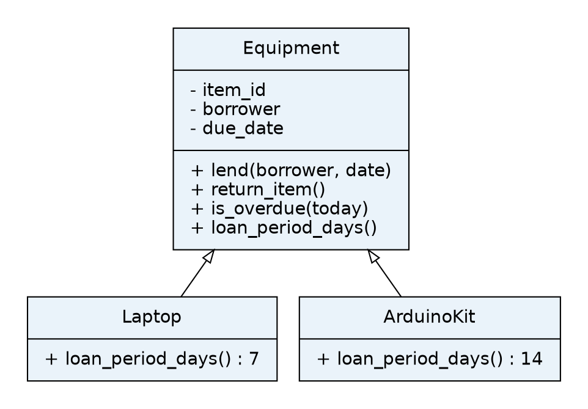

# Lab Equipment Loans

Option B for UFP0007. This practice project will track laptops and Arduino kits borrowed by students, record returns, and list overdue loans.

## Running the program

Once the Python program has been implemented, open a terminal in this folder and run `python main.py` (or `py main.py` on Windows). The current practice milestone contains the design only.

## Design

Each item calculates its due date using its own loan period. For this practice design, laptops have a seven-day loan period and Arduino kits have a fourteen-day loan period.
